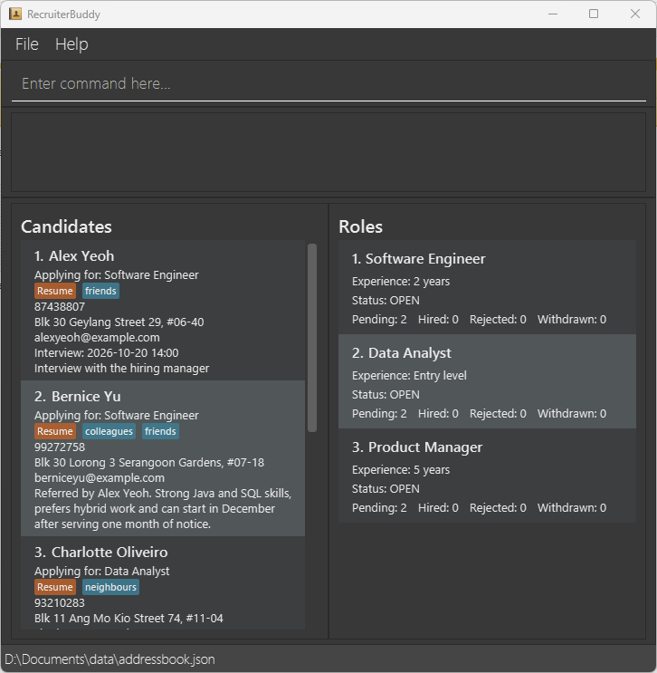
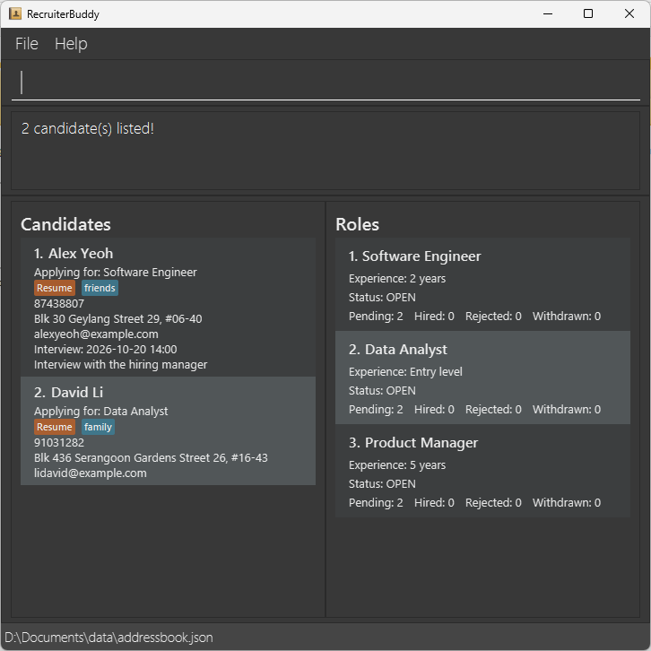

# RecruiterBuddy User Guide

RecruiterBuddy is a **desktop application for department recruiters who fill a small number of vacancies within one department**. It helps you keep candidate details, track the role each candidate is applying for, record upcoming interviews, and see where each candidate stands in the recruitment process.

RecruiterBuddy is optimised for use through a Command Line Interface (CLI) while retaining the benefits of a Graphical User Interface (GUI). If you type quickly, RecruiterBuddy can help you update recruitment records faster than traditional GUI applications.

<!-- * Table of Contents -->
<page-nav-print />

--------------------------------------------------------------------------------------------------------------------

## Quick start

1. Ensure that Java `25` or later is installed on your computer.<br>
   **Mac users:** Ensure you have the precise JDK version prescribed [here](https://se-education.org/guides/tutorials/javaInstallationMac.html).

1. Download the latest `.jar` file from [here](https://github.com/AY2627S1-CS2103-F12-3/tp/releases).

1. Copy the file to an empty folder you want to use for RecruiterBuddy.

1. Open a terminal, `cd` to the folder containing the JAR file, and run `java -jar addressbook.jar`.<br>
   A GUI similar to the one below should appear in a few seconds. Note how the app contains some sample data.<br>
   

   <box type="warning" seamless>

   **Caution:**
   Always launch RecruiterBuddy this way. RecruiterBuddy creates its data, preferences, and log files
   in the folder it is launched from. Other ways of launching it, such as double-clicking the JAR file,
   may launch it from a different folder, depending on your operating system. RecruiterBuddy would then
   create and use files in that folder instead of the JAR file's folder.
   </box>

1. Type a command in the command box and press Enter to execute it. For example, type **`help`** and press Enter to open the help window.<br>
   Some example commands you can try:

   * `list` : Lists all candidates.
   * `list role` : Lists all unique roles, with each role shown in its own box.
   * `role add r/Software Engineer x/2 years` : Adds an open role.

   * `add n/John Doe p/98765432 e/johnd@example.com a/John street, block 123, #01-01 r/Data Analyst` : Adds a candidate named `John Doe` who is applying for the sample `Data Analyst` role.

   * `note 1 Interview 2026-10-20 14:00` : Records an interview date and time for the 1st candidate.

   * `delete 3` : Deletes the 3rd candidate shown in the current list.

   * `clear` : Deletes all candidates and roles.

   * `exit` : Exits the app.

1. Refer to the [Features](#features) section below for details of each command.

--------------------------------------------------------------------------------------------------------------------

## Features

<box type="info" seamless>

**Notes about the command format:**<br>

* Words in `UPPER_CASE` are the parameters to be supplied by the user.<br>
  For example, in `add n/NAME`, replace `NAME` with a value such as `John Doe`.

* Items in square brackets are optional.<br>
  For example, `n/NAME [t/TAG]` can be used as `n/John Doe t/friend` or as `n/John Doe`.

* Items followed by `...` can appear zero or more times.<br>
  For example, `[t/TAG]... ` may be omitted, or written as `t/friend` or `t/friend t/family`.

* Parameters can be in any order.<br>
  For example, if the command specifies `n/NAME p/PHONE_NUMBER`, `p/PHONE_NUMBER n/NAME` is also acceptable.

* Extraneous parameters for `help`, `exit`, and `clear` are ignored.<br>
  For example, `help 123` is interpreted as `help`. `list` accepts only `list` or `list role`; anything else is rejected.

* If you are using a PDF version of this document, be careful when copying and pasting commands that span multiple lines as space characters surrounding line-breaks may be omitted when copied over to the application.
</box>

### Viewing help: `help`

Shows a message explaining how to access the help page.


Format: `help`


### Adding a candidate: `add`

Adds a candidate who is applying for a role.

Format: `add n/NAME p/PHONE_NUMBER e/EMAIL a/ADDRESS r/ROLE [t/TAG]... `

* `ROLE` must be the title of an existing role that is `OPEN`. Use [`role add`](#adding-a-role-role-add) to create the role first.
* `ROLE` is matched ignoring case; for example, `r/software engineer` matches the role `Software Engineer`. The candidate is saved with the role's own spelling of the title.
* A candidate cannot be added if another candidate has exactly the same name. Names are case-sensitive, so `John Doe` and `john doe` are treated as different candidates. Candidates with different names may share a phone number or email address.
* Newly added candidates are automatically assigned the status `Pending Resume Screening`.
* The candidate's card shows the role as `Applying for: ROLE`.

<box type="tip" seamless>

**Tip:** A candidate can have any number of tags, including zero.
</box>

Examples:
* `add n/John Doe p/98765432 e/johnd@example.com a/John street, block 123, #01-01 r/Software Engineer`
* `add n/Betsy Crowe t/referral e/betsycrowe@example.com a/Newgate Prison p/1234567 r/product manager t/java`

### Adding a role: `role add`

Records a vacancy with its title and required experience level. Each role represents exactly one
vacancy; there is no opening-count field.

Format: `role add r/ROLE_TITLE x/EXPERIENCE_LEVEL`

Both `r/` and `x/` are required, must appear exactly once, and may appear in either order.
Leading and trailing whitespace is removed from each value before validation and storage.

* `ROLE_TITLE`: 1–100 characters after trimming, with at least one letter. It may contain letters,
  digits, spaces, apostrophes (`'`), ampersands (`&`), hyphens (`-`), slashes (`/`), and full stops (`.`).
* `EXPERIENCE_LEVEL`: 1–50 printable characters after trimming, with no embedded newlines, tabs,
  or other control characters. Examples include `Entry level`, `2 years`, and `Senior`.
* Role titles must be unique across both `OPEN` and `CLOSED` roles, ignoring case and surrounding
  whitespace. Changing the experience level does not make a title distinct. Internal spaces are
  significant: a title with one space between words differs from one with two consecutive spaces.

Examples:

* `role add r/Software Engineer x/2 years`
* `role add x/Entry level r/Product Analyst`

On success, RecruiterBuddy shows `Added open role: ROLE_TITLE.` and saves the role with status `OPEN`.
Run `list role` to display it; `role add` itself returns to the candidate list.

If validation fails, no role is created:

* Missing title prefix: `Missing required field: r/.`
* Missing experience prefix: `Missing required field: x/.`
* Repeated prefix: `Multiple values specified for the following single-valued field(s): PREFIX`.
  For example, repeating `x/` reports that prefix even if both values are identical.
* Empty or invalid title: `Role title must be 1–100 characters and contain a letter.`
* Empty or invalid experience level:
  `Required experience level must be 1–50 characters and must not contain a new line.`
* Duplicate title: `A role named “ROLE_TITLE” already exists.`
* Text before the first prefix: `Invalid command format!`, followed by the command's usage and example.

Closing a role does not release its title. An unused role can instead be removed with `role delete`
before creating another role with that title.

### Closing a role: `role close`

Ends recruitment while retaining the role and all its candidate records.

Format: `role close INDEX`

Run `list role` first. `INDEX` must be a positive integer shown in the current role list.
The role must be `OPEN`. Every associated candidate must be `HIRED`, `REJECTED`, or `WITHDRAWN`,
and at most one may be `HIRED`. A role with no candidates, or no hired candidate, may also be closed.
Checks include candidates hidden by filters. Candidates loaded without a saved status receive
`PENDING_RESUME_SCREENING` and must receive a final outcome before closure.

Example: `list role`, followed by `role close 1`.

Success shows `Closed role: ROLE_TITLE.` and changes the displayed status to `CLOSED`.
The role and its candidates are saved automatically; candidate statuses remain unchanged.
New candidates cannot be added to the closed role. A role is never closed automatically.

If closure fails, no records change:

* Pending candidates: `Cannot close role: ROLE_TITLE. N candidate(s) still pending.`
* Multiple hired candidates: `Cannot close role: ROLE_TITLE. More than one candidate is marked HIRED.`
* Already closed: `ROLE_TITLE is already closed.`
* Invalid or missing index: `Role index must refer to a displayed role.`
* Extra arguments: `The role close command takes only a role index.`
* Candidate list displayed: `The role list is not displayed. Use list role first.`

### Deleting a role: `role delete`

Permanently removes a role entered by mistake. Run `list role` first.

Format: `role delete INDEX`

`INDEX` must be a positive integer shown in the current role list. An `OPEN` or `CLOSED` role
can be deleted only when it has no associated candidates. All candidates are checked, including
those hidden by filters and those marked `HIRED`, `REJECTED`, or `WITHDRAWN`.

Example: `list role`, followed by `role delete 1`.

Success shows `Deleted role: ROLE_TITLE.`. The role disappears, remaining displayed indices update,
and the change is saved automatically. Its title can be used again with `role add`.
Deletion is immediate and permanent. It never deletes, detaches, or reassigns candidates.

If deletion fails, no records change:

* Associated candidates: `Cannot delete role: ROLE_TITLE. It has N associated candidate(s).`
* Invalid or missing index: `Role index must refer to a displayed role.`
* Extra arguments: `The role delete command takes only a role index.`
* Candidate list displayed: `The role list is not displayed. Use list role first.`

Use `role close` to finish recruitment and retain its history; `role delete` removes an unused role.

### Listing all candidates: `list`

Shows a list of all candidates.

Format: `list`

### Listing all roles: `list role`

Shows every unique role in RecruiterBuddy. Each role is displayed in its own box with its title, required experience level, and status.

Format: `list role`

Role indices can be used only while the role list is displayed. If a successful command such as
adding or finding a candidate switches back to the candidate list, run `list role` again before
using `role close` or `role delete`. Failed commands leave the current list displayed.

### Editing a candidate: `edit`

Edits an existing candidate.

Format: `edit INDEX [n/NAME] [p/PHONE] [e/EMAIL] [a/ADDRESS] [t/TAG]... `

* Edits the candidate at the specified `INDEX`. The index refers to the index number shown in the displayed candidate list. The index **must be a positive integer** 1, 2, 3, ...
* At least one of the optional fields must be provided.
* Existing values will be updated to the input values.
* When editing tags, all of the candidate's existing tags are removed; adding tags is not cumulative.
* To remove all of a candidate's tags, enter `t/` without a tag after it.
* A candidate's role cannot be edited, so `r/` is rejected. The candidate's status and note are also kept; use `status` or `note` to change them.

Examples:
*  `edit 1 p/91234567 e/johndoe@example.com` Edits the phone number and email address of the 1st candidate to be `91234567` and `johndoe@example.com` respectively.
*  `edit 2 n/Betsy Crower t/` Edits the name of the 2nd candidate to be `Betsy Crower` and clears all existing tags.

### Adding or clearing a note: `note`

Records a note for an existing candidate, such as an interview date and time.

Format: `note INDEX [NOTE]`

* Sets the note of the candidate at the specified `INDEX`. The index refers to the index number shown in the displayed candidate list. The index **must be a positive integer** 1, 2, 3, ...
* Everything after the index is saved as the note, with leading and trailing spaces removed. The note can contain any text, including text that looks like a prefix, such as `t/` or `n/`.
* A new note replaces the candidate's existing note.
* To clear a candidate's note, enter `note INDEX` without a note after it.
* To record or reschedule an interview, write its date and time in the note. RecruiterBuddy does not check that the date and time are valid.

Examples:
*  `note 1 Interview 2026-10-20 14:00` Sets the note of the 1st candidate to `Interview 2026-10-20 14:00`.
*  `note 2 Discuss t/java experience` Sets the note of the 2nd candidate to `Discuss t/java experience`.
*  `note 3` Clears the note of the 3rd candidate.

### Locating candidates by name: `find`

Finds candidates whose names contain any of the given keywords.

Format: `find KEYWORD [MORE_KEYWORDS]`

* The search is case-insensitive; for example, `hans` matches `Hans`.
* Keyword order does not matter; for example, `Hans Bo` matches `Bo Hans`.
* The search considers only names.
* Only full words match; for example, `Han` does not match `Hans`.
* Candidates matching at least one keyword are returned (an `OR` search); for example, `Hans Bo` returns `Hans Gruber` and `Bo Yang`.

Examples:
* `find John` returns `john` and `John Doe`
* `find alex david` returns `Alex Yeoh`, `David Li`<br>
  

### Updating a candidate's status: `status`

Updates the recruitment status of the candidate at the specified index.

Format: `status INDEX STATUS`

* Updates the status of the candidate at the specified `INDEX`. The index refers to the index number shown in the displayed candidate list. The index **must be a positive integer** 1, 2, 3, ... and cannot exceed the length of the _displayed_ candidate list.
* The candidate's original status is replaced with the one specified in `STATUS`.
* `STATUS` must be one of the following: `PENDING_RESUME_SCREENING`, `PENDING_RECRUITER_INTERVIEW`, `PENDING_OFFER_EXTENSION`, `PENDING_OFFER_DECISION`, `HIRED`, `REJECTED`, or `WITHDRAWN`.
* `STATUS` is not case-sensitive; for example, `hired`, `Hired` and `hiRED` are treated as the same as `HIRED`.
* Each role has one vacancy. Assigning `HIRED` fails if another candidate for the same role is already
  `HIRED`, including candidates hidden by filters. Role titles are compared without case sensitivity.
  The error is `ROLE_TITLE already has a hired candidate.` No candidate data changes.
* Reapplying `HIRED` to the same candidate is allowed when no other candidate for that role is hired.
  Marking a candidate `HIRED` does not close the role; use `role close` explicitly after all candidates
  have final outcomes.
* For an `OPEN` role, a candidate with a final outcome (`HIRED`, `REJECTED`, or `WITHDRAWN`) may return
  to any of the four `PENDING_*` statuses to correct or resume their recruitment process.
* For a `CLOSED` role, assigning any `PENDING_*` status is rejected with
  `Cannot set a pending status for NAME because role ROLE_TITLE is closed.` The candidate, role,
  current filter, and saved records remain unchanged. Corrections between final outcomes are still
  allowed, subject to the one-hired-candidate rule. Reopening a role is not supported in the MVP.

Example:

* `status 1 pending_offer_extension`
* `status 2 PENDING_RECRUITER_INTERVIEW`
* `status 1 HIRED`

### Deleting a candidate: `delete`

Deletes the specified candidate.

Format: `delete INDEX`

* Deletes the candidate at the specified `INDEX`.
* The index refers to the index number shown in the displayed candidate list.
* The index **must be a positive integer** 1, 2, 3, ...

Examples:
* `list` followed by `delete 2` deletes the 2nd candidate in RecruiterBuddy.
* `find Betsy` followed by `delete 1` deletes the 1st candidate in the results of the `find` command.

### Clearing all entries: `clear`

Clears all candidates and roles from RecruiterBuddy.

Format: `clear`

### Exiting the program: `exit`

Exits the program.

Format: `exit`

### Saving the data

RecruiterBuddy automatically saves the complete candidate and role data after a command executes
successfully, including commands such as `list` that do not change records. You do not need to save
manually. Commands rejected during parsing or validation do not trigger a save.

Saved roles retain their titles, required experience levels, and `OPEN` or `CLOSED` statuses after
restarting. Candidates associated with closed roles are retained too. If no data file exists,
RecruiterBuddy starts with sample roles and candidates, not an empty data set.

If saving fails, an error reports the file-access problem instead of the normal success message.
Changes already made may remain in the current session without being saved. Resolve the file-access
problem and run a successful command to retry saving before exiting.

### Editing the data file

RecruiterBuddy saves data in `data/addressbook.json`, inside the folder it was launched from. If you
launched it as described in [Quick start](#quick-start), this is the folder containing the JAR file.
The file is created after the first successfully executed command.
Advanced users may edit this JSON file while the application is closed. Back it up first.

The file contains a `persons` array for candidates and a `roles` array for role openings.
For example, this complete file contains one role and no candidates:

```json
{
  "persons": [],
  "roles": [
    {
      "title": "Software Engineer",
      "experienceLevel": "2 years",
      "status": "OPEN"
    }
  ]
}
```

When editing roles and their candidate associations:

* Every role needs `title`, `experienceLevel`, and `status`. Title and experience values must satisfy
  the same constraints as `role add`; role status must be exactly `OPEN` or `CLOSED` in uppercase.
* Do not repeat role titles, even with different capitalisation or experience levels.
* Each candidate's `role` field must name an existing role, ignoring case. It may name a closed role,
  because closing preserves candidates. On loading, the role's stored capitalisation is used for
  its candidates. If you rename a role in the file, update every associated candidate's `role` too.
* A candidate's saved `status` uses an uppercase status name, such as `HIRED`. If absent, it defaults
  to `PENDING_RESUME_SCREENING`. A missing candidate `role` has no default and prevents loading;
  older contact-only files therefore need role information added before they can be used.
* Keep recruitment outcomes consistent: at most one candidate per role should be `HIRED`, and closed
  roles should have no pending candidates. The status and close commands enforce these rules during
  normal use; do not rely on the loader to detect every inconsistent outcome introduced by hand.

<box type="warning" seamless>

**Caution:**
Malformed JSON, invalid role fields, duplicate role titles, or a candidate referring to a nonexistent
role prevent the whole file from loading; valid records are not loaded separately.
If the file cannot be read or validated, RecruiterBuddy shows an **Unable to load recruitment data**
error containing the file's full path. After you dismiss the error, the application closes without
opening the command window or changing the recruitment-data file. Restore your own backup, correct
the invalid data, or resolve the file-access problem before restarting. If you intentionally want
to start again with sample data, first move the original file to a safe location yourself.
No automatic backup, recovery, or migration of old contact-only files is provided. A genuinely missing
file still starts the application with sample data; a valid file containing empty lists stays empty.
</box>

### Archiving data files `[coming in v2.0]`

_Details coming soon ..._

--------------------------------------------------------------------------------------------------------------------

## FAQ

**Q**: How do I transfer my data to another computer?<br>
**A**: Install the app on the other computer and overwrite the data file it creates with `data/addressbook.json` from the folder containing your previous RecruiterBuddy JAR file.

--------------------------------------------------------------------------------------------------------------------

## Known issues

1. **When using multiple screens**, if you move the application to a secondary screen, and later switch to using only the primary screen, the GUI will open off-screen. The remedy is to delete the `preferences.json` file created by the application before running the application again.
2. **If you minimize the Help Window** and then run the `help` command (or use the `Help` menu, or the keyboard shortcut `F1`) again, the original Help Window will remain minimized, and no new Help Window will appear. The remedy is to manually restore the minimized Help Window.
3. **If RecruiterBuddy is launched from a folder other than the JAR file's folder** (for example, by double-clicking the JAR file on some systems), it reads and writes `data/addressbook.json`, `preferences.json`, and `addressbook.log` in that other folder. It may then show sample data instead of your saved data. The remedy is to close the application, back up the `data/addressbook.json` files in both folders, decide which one to keep, copy it into the `data` folder beside the JAR file, and relaunch RecruiterBuddy as described in [Quick start](#quick-start).

--------------------------------------------------------------------------------------------------------------------

## Command summary

Action     | Format, Examples
-----------|----------------------------------------------------------------------------------------------------------------------------------------------------------------------
**Add**    | `add n/NAME p/PHONE_NUMBER e/EMAIL a/ADDRESS r/ROLE [t/TAG]... ` <br> e.g., `add n/James Ho p/22224444 e/jamesho@example.com a/123, Clementi Rd, 1234665 r/Software Engineer t/referral t/java`
**Clear**  | `clear`
**Delete** | `delete INDEX`<br> e.g., `delete 3`
**Edit**   | `edit INDEX [n/NAME] [p/PHONE_NUMBER] [e/EMAIL] [a/ADDRESS] [t/TAG]... `<br> e.g.,`edit 2 n/James Lee e/jameslee@example.com`
**Find**   | `find KEYWORD [MORE_KEYWORDS]`<br> e.g., `find James Jake`
**List**   | `list`
**List roles** | `list role`
**Note**   | `note INDEX [NOTE]`<br> e.g., `note 1 Interview 2026-10-20 14:00`
**Role add** | `role add r/ROLE_TITLE x/EXPERIENCE_LEVEL`<br> e.g., `role add r/Software Engineer x/2 years`
**Role close** | `role close INDEX`<br> e.g., `list role` followed by `role close 1`
**Role delete** | `role delete INDEX`<br> e.g., `list role` followed by `role delete 1`
**Status** | `status INDEX STATUS`<br> e.g., `status 1 HIRED`
**Help**   | `help`
